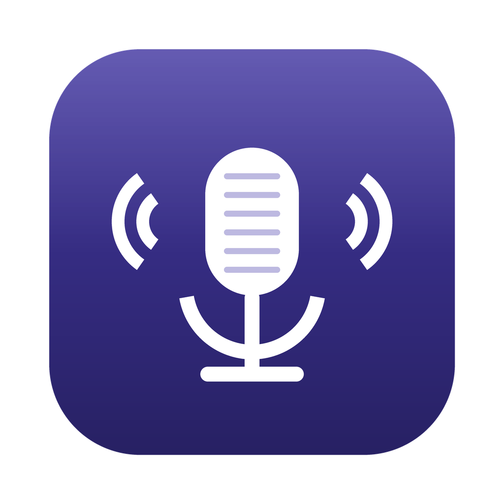

<div align="center">
  
  <h1>SHOWhisper</h1>
  <p><strong>Local, private voice dictation for macOS &amp; Windows.</strong></p>
  <p>Press a hotkey, speak, and your words are transcribed on-device with Whisper and pasted into whatever app you're in. No cloud, no account, nothing leaves your machine.</p>
</div>

---

## Features

- 🎙️ **Global hotkey dictation** — press <kbd>⌥</kbd> <kbd>Space</kbd> to start, press again to stop. The transcript is pasted at your cursor.
- 🧠 **On-device summaries** — press <kbd>⌥</kbd> <kbd>⇧</kbd> <kbd>Space</kbd> instead and the dictation is summarized by a local LLM before it's pasted (the full transcript stays on your clipboard). Runs fully offline via [node-llama-cpp](https://node-llama-cpp.withcat.ai/).
- 📁 **File transcription** — pick or drag in a media file (mp4, mov, mp3, m4a, wav …) and get a transcript in a result window, with an optional summary and copy/save.
- 🔒 **Fully local & private** — transcription runs on-device via [Whisper](https://github.com/openai/whisper) (ONNX / [transformers.js](https://github.com/huggingface/transformers.js)), and summaries via a local GGUF model. Nothing leaves your computer.
- 🪟 **Floating pill overlay** — a small, always-on-top capsule shows a live waveform while recording, progress while transcribing, and a ✓ when done. Drag it anywhere; its position is remembered.
- 🍎 **Menubar app** — lives in the tray/menubar, no dock clutter. Pick your model from the menu.
- ⚡ **Apple Silicon acceleration** — uses CoreML on macOS where available, with an automatic CPU fallback.
- 🧩 **Model choice** — from `tiny` (fast) to `large` (best quality), downloaded on demand and cached locally.
- 💬 **Spoken quote markers** — say a marker phrase around direct speech and it becomes proper typographic quotes in your language (see below).

## Dictating quotes

Whisper can't tell direct speech from description on its own, so you mark it by voice. Speak an *open* phrase, the quoted words, then a *close* phrase, and the app rewrites them into the correct quotation marks for the selected transcription language.

Example (German): saying *“Er sagte Zitat Anfang das ist unmöglich Zitat Ende”* produces **Er sagte „das ist unmöglich“**.

| Language | Open (say one of) | Close (say one of) | Result |
|----------|-------------------|--------------------|--------|
| German   | „Zitat Anfang“, „Anführungszeichen auf“ | „Zitat Ende“, „Anführungszeichen zu“ | `„…“` |
| English  | “open quote”, “begin quote”, “quote” | “close quote”, “end quote”, “unquote” | `“…”` |
| French   | « ouvrez les guillemets », « ouvrir les guillemets », « citation » | « fermez les guillemets », « fermer les guillemets », « fin de citation » | `« … »` |

Marker matching is case-insensitive and tolerates the commas Whisper tends to insert. It's always on and only changes text when you actually speak a marker.

## Summarizing your dictation

Press <kbd>⌥</kbd> <kbd>⇧</kbd> <kbd>Space</kbd> (instead of <kbd>⌥</kbd> <kbd>Space</kbd>) to dictate **and** summarize. The audio is transcribed, then condensed by a local LLM in the same language, and the **summary** is pasted at your cursor while the **full transcript** is left on your clipboard.

The summary runs fully offline. The first time you use it, a GGUF model is downloaded once (~2.5 GB) and cached under the app's user-data directory (`llm-cache`); after that it works with no network. The default model is [`Qwen3-4B-Instruct-2507`](https://huggingface.co/unsloth/Qwen3-4B-Instruct-2507-GGUF) (a current, multilingual, non-thinking instruct model). To use a different model, set the store key `llmModelUri` to any node-llama-cpp `hf:owner/repo:quant` URI or a local `.gguf` path.

> Summaries need noticeably more RAM than dictation (a 4B Q4 model uses roughly 2.5–3.5 GB). On a 16 GB machine, prefer a smaller Whisper model if you summarize a lot.

## Transcribing a file

Choose **Transcribe file…** from the tray menu, or drag a media file onto the result window. The file is decoded with a bundled ffmpeg (so any common container/codec works — mp4, mov, mkv, webm, mp3, m4a, wav, …) and transcribed with Whisper. The result window shows the transcript with **Copy**, **Save…**, and a **Summarize** button (same local LLM as above).

Files can use a **different (larger) Whisper model** than live dictation — pick it in the result window's model selector. Latency doesn't matter for files, so `medium`/`large` gives better accuracy. It's loaded only for the file and disposed afterwards, so your fast dictation model stays loaded and active. The choice is remembered separately (store key `fileModel`); changing it re-transcribes the current file.

## Hotkeys

Both hotkeys are global (work in any app) and toggle: press once to start recording, press again to stop. On macOS <kbd>⌥</kbd> is Option; on Windows it's <kbd>Alt</kbd>.

| Hotkey | Action |
|--------|--------|
| <kbd>⌥</kbd> <kbd>Space</kbd> | **Dictate.** Transcribe your speech and paste it at the cursor. |
| <kbd>⌥</kbd> <kbd>⇧</kbd> <kbd>Space</kbd> | **Dictate + summarize.** Transcribe, summarize with the local LLM, paste the summary; the full transcript stays on the clipboard. |

Not a hotkey, but handy: **drag the floating pill** to reposition it anywhere on screen — its position is remembered. Everything else (model choice, file transcription, settings, quit) is in the **tray/menubar menu**. Hotkeys are currently fixed and not yet configurable.

## How it works

```
⌥Space ─► global shortcut (main process)
               ├─ overlay pill: recording → transcribing → done
               ├─ Web Audio (renderer): capture + resample to 16 kHz mono PCM
               ├─ Whisper (transformers.js): PCM → text
               └─ clipboard + simulated ⌘V / Ctrl+V → paste into focused app
```

The <kbd>⌥</kbd> <kbd>Space</kbd> toggle is registered through Electron's built-in `globalShortcut` (the OS hot-key API), so it never sits in the system-wide input path and can't stall keyboard or mouse input.

## Requirements

- macOS 12+ (Apple Silicon or Intel) or Windows 10/11
- [Node.js](https://nodejs.org/) 18+ and npm (for building from source)

### Permissions (macOS)

On first launch macOS will ask for these permissions:

| Permission | Why | Where to grant |
|------------|-----|----------------|
| **Microphone** | recording your voice (required) | System Settings → Privacy & Security → Microphone |
| **Accessibility** | simulated paste of the transcript (optional: without it the text stays on the clipboard for a manual paste) | System Settings → Privacy & Security → Accessibility |

## Installing the app (macOS `.dmg`)

The `.dmg` is **ad-hoc signed but not notarized** (building a notarized release needs a paid Apple Developer account). It runs perfectly fine, but macOS Gatekeeper shows a warning on the very first launch that you have to click past **once**. This is expected — follow the steps below.

1. **Download** `SHOWhisper-<version>-<arch>.dmg`. Pick `arm64` for Apple Silicon (M1/M2/M3/M4) or `x64` for Intel Macs.
2. **Open the `.dmg`** and drag **SHOWhisper** into your **Applications** folder.
3. **First launch — get past Gatekeeper.** Double-clicking will say *"SHOWhisper cannot be opened because Apple cannot check it for malicious software"* (or *"is damaged"* on Apple Silicon). Do **one** of these once:
   - **Right-click** (or Control-click) the app in Applications → **Open** → **Open** in the dialog, **or**
   - open it once normally, then go to **System Settings → Privacy & Security** and click **Open Anyway**, **or**
   - run in Terminal: `xattr -cr /Applications/SHOWhisper.app` and open it normally.

   After this one-time confirmation it launches like any other app.
4. **Grant permissions** when prompted — **Microphone** (required) and, for auto-paste, **Accessibility** (see the table above).
5. **First use downloads the models.** The Whisper model (default `small`, ~450 MB) downloads on first launch; the summarization model (~2.5 GB) downloads the first time you use <kbd>⌥</kbd> <kbd>⇧</kbd> <kbd>Space</kbd>. Both are cached locally and afterwards everything runs offline.

> **Why the warning?** Ad-hoc signing is what avoids the harder "app is damaged" rejection on Apple Silicon, but only full notarization removes the prompt entirely. The app is open source — you can also build it yourself (below).

### Windows (`.exe`)

Run the NSIS installer. SmartScreen may show *"Windows protected your PC"* because the build isn't signed with a paid certificate — click **More info → Run anyway**.

## Getting started (from source)

```bash
git clone https://github.com/adziendziolD/SHOWhisper.git
cd SHOWhisper
npm install
npm start
```

The first time you use a model it is downloaded (once) and cached under the app's user-data directory.

## Models

Choose in the tray menu. Larger models are more accurate (especially for German) but need more RAM and are slower.

| Model     | Size   | RAM     | Latency (M1) | Quality |
|-----------|--------|---------|--------------|---------|
| tiny      | 75 MB  | ~125 MB | ~0.5 s       | ⚠️      |
| base      | 150 MB | ~250 MB | ~1 s         | ✅      |
| small     | 450 MB | ~700 MB | ~2–3 s       | ✅✅    |
| medium    | 1.5 GB | ~2.5 GB | ~6–8 s       | ✅✅✅  |
| large     | 3 GB   | ~4.5 GB | ~15 s        | 🏆      |

Default: `small`. Models are loaded from the public [`Xenova`](https://huggingface.co/Xenova) HuggingFace namespace, which hosts all five sizes and needs no access token. Pick the model in the tray menu.

> **Language:** German, English and French are selectable in **Settings**, and the whole UI localizes to the chosen language.

## Building installers

```bash
npm run build
```

Output lands in `dist/` (`.dmg` on macOS, NSIS `.exe` on Windows). Native modules are unpacked from the asar archive automatically (see `electron-builder.yml`).

> **After building, launch the packaged app once and run the full flow** (hotkey → model load → dictation → paste) — native modules only fully exercise in the packaged build, not just `npm start`.

### Code signing & notarization (macOS)

The build is **ad-hoc signed** (`mac.identity: "-"` in `electron-builder.yml`), which needs no Apple Developer account. This is what keeps Apple Silicon from rejecting the app with the hard "app is damaged" error. It is **not** notarized, so on first launch Gatekeeper still shows "SHOWhisper cannot be verified". Recipients open it once via:

- **right-click → Open** → *Open* in the dialog, or
- **System Settings → Privacy & Security → Open Anyway**, or
- `xattr -cr /Applications/SHOWhisper.app` in the Terminal.

After that first confirmation it launches normally.

For fully frictionless opening (no prompt at all) you need an [Apple Developer Program](https://developer.apple.com/programs/) membership and a *Developer ID Application* certificate, then set in `electron-builder.yml`:

```yaml
mac:
  identity: "Developer ID Application: Your Name (TEAMID)"
  hardenedRuntime: true
  notarize: true   # needs APPLE_ID / APPLE_APP_SPECIFIC_PASSWORD / APPLE_TEAM_ID env vars
```

## Development

```bash
npm run dev     # electron with NODE_ENV=development + devtools + verbose logs
npm run lint    # eslint
```

Verbose per-token / PCM diagnostics and transcript logging are only emitted in development mode — production builds keep logs minimal and never log the recognized text.

## Roadmap

- Auto-update via `electron-updater`
- Transcription history
- More languages / auto-detect
- Custom hotkey

## Tech stack

Electron (built-in `globalShortcut` for the hotkey) · [@huggingface/transformers](https://github.com/huggingface/transformers.js) (Whisper via ONNX) · [@nut-tree-fork/nut-js](https://github.com/nut-tree/nut.js) (paste simulation) · electron-store · electron-builder

## License

[MIT](LICENSE) © Adziendz
